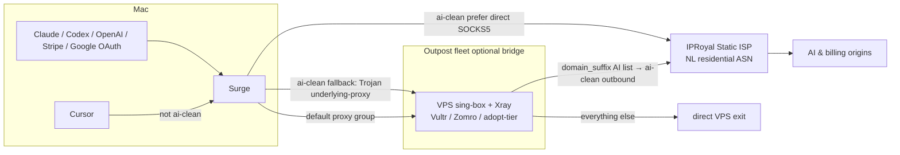

# AI-clean network (Fleet v2)

Correct exit path for AI agents, billing, and Google OAuth after the 2026-11
clean-account rebuild. General browsing still uses the Outpost VPS fleet;
**AI/billing must leave via a Static Residential (ISP) hop**, not a datacenter ASN.

## Topology

## Rules that matter

| Traffic | Path | Why |
|---|---|---|
| Claude, Codex, OpenAI, Stripe, OpenRouter, Google OAuth | `ai-clean` → Static ISP | Datacenter ASNs get fraud-flagged / banned |
| Cursor (`cursor.sh` / Helper) | **default Outpost group, not `ai-clean`** | Forcing Cursor through `ai-clean` breaks live chat streams on `surge-cli reload` |
| General / blocked sites | Outpost Trojan (TCP). Hy2 only if UDP works | From this ISP, Hy2 UDP handshakes often time out |

## Config knobs

- `OUTPOST_AI_PROXY_URL` — SOCKS5/HTTP upstream (URL or IPRoyal `host:port:user:pass`). Wired into sing-box + Xray route rules and Surge `ai-clean-isp`.
- `VULTR_API_KEY` — optional Fleet v2 provisioner. Direct ISP is enough for AI; Vultr is a bridge/backup, not required.
- `scripts/orca-clean-agent.sh` — preflight kill-switch (refuse RU / Aeza / Zomro exits) + isolated `CLAUDE_CONFIG_DIR`.

Domain list lives in `outpost/server/singbox.py` → `AI_CLEAN_DOMAIN_SUFFIXES` (shared by render, sing-box, Xray).

## Provider posture

- **Vultr** — `policy_ok: true`, primary cloud for new bridges (AMS/FRA/STO/WAW).
- **Aeza** — retired for new provision (`policy_ok: false`): OFAC + blocked subnets.
- **Hostkey** — still parked by operator choice.
- **iphoster** — adopt-tier only.
